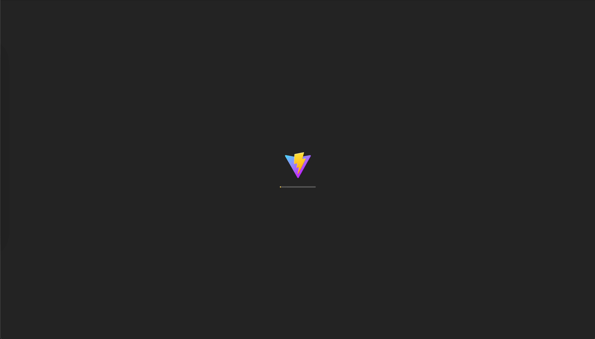

<h1 align='center'>vite-plugin-splash-screen</h1>

<div align="center" >
  &middot;
  <i>Framework-agnostic splash screen plugin for Vite</i>
  &middot;
  <br/>
  <br/>
  
  
  <br/>
  <br/>
</div>



## 💦 Features

When building a Single-Page-Application (SPA) that is fully rendered on the client side (CSR), it is common to only send a minimal HTML file to the client which only defines a single div as the root of the app and includes links and scripts to load all the necessary assets to render the application.

This common approach will lead to a blank screen for a few seconds while the JS is being loaded and parsed. To improve the user experience we can add a splash screen, which are commonly used in mobile applications, that is displayed while the assets are being loaded and parsed. Then when your application is ready and initialized, the splash screen can be animated out of the way to reveal the application.

With `vite-plugin-splash-screen` you get the following:

- **🤹 Framework-agnostic**: Works with any frontend framework that uses Vite!
- **🎨 Customizable**: You can customize the splash screen with your own logo, change colors, and display a loading indicator.
- **🚀 Fast**: The splash screen is inlined to the HTML file at build time.
- **🕹️ Full control**: You can control when the splash screen is hidden.
- **🔮 Easy to use**: Just add the plugin to your Vite config and you are good to go.

## 📲 Installation

Install `vite-plugin-splash-screen` with your favorite package manager:

```sh
npm install -D vite-plugin-splash-screen

# yarn
yarn add -D vite-plugin-splash-screen

# pnpm
pnpm add -D vite-plugin-splash-screen
```

## 🧑‍💻 Usage

Import the plugin and add it to you Vite config.

The only required option is `logoSrc`, the path to the logo that is displayed on the splash screen.

```js
import { splashScreen } from 'vite-plugin-splash-screen';

export default defineConfig({
  plugins: [
    /* ...other plugins... */
    splashScreen({
      logoSrc: 'logo.svg',
    }),
  ],
});
```

The logo file is inlined into the HTML as-is, so it can be either an **SVG** or an **HTML snippet** (`.html`), eg. text with CSS animations. `logoSrc` is resolved in this order:

1. Relative to the [publicDir](https://vitejs.dev/config/shared-options.html#publicdir) (eg. `"logo.svg"` → `public/logo.svg`)
2. Relative to the project root (eg. `"src/splash-logo.html"`)
3. An absolute file path

If the file can't be found, the plugin throws an error listing the paths it tried. In dev mode, editing the logo file reloads the page automatically.

> [!TIP]
> Make sure the logo has appropriate dimensions and is optimized for the web. See [SVGOMG](https://jakearchibald.github.io/svgomg/) for optimizing SVG files.

Then in your application code (written in React, Vue, Svelte, whatever), you can hide the splash screen when the application is ready.

```js
import { hideSplashScreen } from 'vite-plugin-splash-screen/runtime';

hideSplashScreen();
```

For example in a React app, you can hide the splash screen in the `useEffect` hook.

```jsx
import { useEffect } from 'react';
import { hideSplashScreen } from 'vite-plugin-splash-screen/runtime';

export function App() {
  useEffect(() => {
    hideSplashScreen();
  }, []);

  return <div>My App</div>;
}
```

`hideSplashScreen()` returns a promise that resolves once the splash screen has been removed from the page. Calling it multiple times is safe, and it does nothing outside the browser (eg. during SSR or in tests).

> [!TIP]
> You should wait until your application is fully initialized before hiding the splash screen. This could include setting up a router, initializing a store, loading translations, authenticating the user, or loading data from an API etc.

## 🎨 Customization

You can customize the splash screen by providing additional options to the plugin.

### `minDurationMs`

The minimum duration the splash screen should be displayed, even if the `hideSplashScreen` function has been called.
This is useful to prevent the splash screen from flickering in case the app is initialized very quickly.

For example, to display the splash screen for at least 2 seconds:

```js
splashScreen({
  logoSrc: 'logo.svg',
  minDurationMs: 2000,
});
```

### `fadeDurationMs`

Duration of the fade-out animation in milliseconds (default `200`). The fade is skipped when the user [prefers reduced motion](https://developer.mozilla.org/en-US/docs/Web/CSS/@media/prefers-reduced-motion).

```js
splashScreen({
  logoSrc: 'logo.svg',
  fadeDurationMs: 400,
});
```

### `waitForAnimations`

When `true`, the splash screen waits for finite CSS animations inside it (eg. a one-shot logo animation) to finish before fading out (default `false`). Infinite animations, such as the loading indicators, are ignored, and the wait is capped at 5 seconds so a broken animation can't block your app.

This lets a logo animation complete without hand-tuning `minDurationMs`.

```js
splashScreen({
  logoSrc: 'splash-logo.html',
  waitForAnimations: true,
});
```

### How the timing options interact

After `hideSplashScreen()` is called, the splash screen goes through these steps:

1. Wait until at least `minDurationMs` has passed since the splash screen was rendered.
2. Set `data-vpss-state="hiding"` on the splash element (see [Animated logos](#animated-logos)).
3. If `waitForAnimations` is enabled, wait for finite animations to finish (max 5 seconds). This includes any exit animation triggered by the `hiding` state.
4. Fade out over `fadeDurationMs` (instantly with reduced motion).
5. Remove the splash screen. The promise returned by `hideSplashScreen()` resolves.

### `ariaLabel`

The accessible label of the splash screen (default `"Loading"`, or the [`loaderText`](#loadertext) with the shimmer loader). The splash element has `role="status"` and `aria-live="polite"` so screen readers announce it, and the logo is hidden from screen readers so eg. an SVG `<title>` isn't read.

```js
splashScreen({
  logoSrc: 'logo.svg',
  ariaLabel: 'Loading My App',
});
```

### `loaderType`

Which built-in loading indicator is displayed below the logo. Only the CSS of the selected loader is added to the page.

| `loaderType`       | Description                                                                |
| ------------------ | -------------------------------------------------------------------------- |
| `"line"` (default) | Indeterminate progress line                                                |
| `"dots"`           | Sliding dots                                                               |
| `"shimmer"`        | Text with a highlight sweeping across it (see [`loaderText`](#loadertext)) |
| `"blocks"`         | Row of squares lighting up in a sweep                                      |
| `"spinner"`        | Rotating ring                                                              |
| `"pulse"`          | Expanding, fading circles                                                  |
| `"bars"`           | Equalizer-style bars                                                       |
| `"bounce"`         | Three bouncing dots                                                        |
| `"orbit"`          | Dot circling a track                                                       |
| `"none"`           | No loading indicator                                                       |

All loaders use the [`loaderBg`](#loaderbg) color. When the user prefers reduced motion, they are shown without movement and with a gentle pulse instead.

With `"dots"` you get the following loading indicator:

```js
splashScreen({
  logoSrc: 'logo.svg',
  loaderType: 'dots',
});
```


Provide `"none"` to hide the loading indicator:

```js
splashScreen({
  logoSrc: 'logo.svg',
  loaderType: 'none',
});
```


### `loaderText`

The text animated by the `"shimmer"` loader (default `"Loading"`). It is also used as the [`ariaLabel`](#arialabel) unless you set one.

```js
splashScreen({
  logoSrc: 'logo.svg',
  loaderType: 'shimmer',
  loaderText: 'Loading your workspace',
});
```

### `loaderBg`

The color of the loading indicator (default `#0072f5`).

Example:

```js
splashScreen({
  logoSrc: 'logo.svg',
  loaderType: 'line',
  loaderBg: '#ff0000',
});
```

### `splashBg`

The background color of the splash screen (default `#ffffff`).

Colors must be plain CSS color values (eg. `#000`, `rgb(0 0 0)`, `black`). Values that could break out of the CSS, such as ones containing `;`, `{` or `}`, are rejected.

Example:

```js
splashScreen({
  logoSrc: 'logo.svg',
  splashBg: '#000000',
});
```

### Dynamic colors

If your app supports theming (eg. light and dark mode), you can dynamically change the colors of the splash screen using CSS variables.

The following CSS variables are available:

- `--vpss-bg-splash` - Splash screen background color (default `#ffffff`)
- `--vpss-bg-loader` - Loading indicator background color (default `#0072f5`)

⚠️ Note: in order to avoid flickering of colors you should set the CSS variables **before** the splash screen is rendered! You can easily achieve this by utilizing the [vite-plugin-color-scheme](https://github.com/Temzasse/vite-plugin-color-scheme) plugin to inline a small script to setup the CSS variables based on the user's preferred color scheme.

```js
import { colorScheme } from 'vite-plugin-color-scheme';
// vite.config.ts
import { splashScreen } from 'vite-plugin-splash-screen';

export default defineConfig({
  plugins: [
    colorScheme({
      defaultScheme: 'light',
      variables: {
        light: {
          '--vpss-bg-splash': '#ffffff',
          '--vpss-bg-loader': '#b18500',
        },
        dark: {
          '--vpss-bg-splash': '#242424',
          '--vpss-bg-loader': '#ffcb29',
        },
      },
    }),
    splashScreen({/* ...your options... */}),
  ],
});
```

## 🛠️ Advanced usage

### Animated logos

You can use an HTML snippet with CSS animations as the logo. Since the logo is inlined into the page as-is, keep in mind:

- **Scope all CSS under a unique root id.** An inlined `<style>` applies to the whole page, not just the logo.
- **Use unique ids** for `clipPath`, gradients, masks etc. so they don't clash with ids used by your app.
- **Include a `prefers-reduced-motion` fallback** that shows the logo without animation.

The splash element has a `data-vpss-state` attribute that is `"visible"` while shown and `"hiding"` once it starts hiding, so the logo can play an exit animation. Combine it with `waitForAnimations: true` to let the animation finish before the fade-out.

```html
<!-- src/splash-logo.html -->
<div id="my-splash-logo">
  <style>
    #my-splash-logo {
      font: 700 40px system-ui;
      animation: my-splash-logo-in 600ms ease-out both;
    }
    #vpss[data-vpss-state='hiding'] #my-splash-logo {
      animation: my-splash-logo-out 400ms ease-in forwards;
    }
    @keyframes my-splash-logo-in {
      from {
        opacity: 0;
        transform: translateY(12px);
      }
    }
    @keyframes my-splash-logo-out {
      to {
        opacity: 0;
        transform: scale(1.1);
      }
    }
    @media (prefers-reduced-motion: reduce) {
      #my-splash-logo,
      #vpss[data-vpss-state='hiding'] #my-splash-logo {
        animation: none;
      }
    }
  </style>
  My App
</div>
```

```js
splashScreen({
  logoSrc: 'src/splash-logo.html',
  waitForAnimations: true,
});
```

### Content Security Policy

The splash screen uses an inline `<style>` and `<script>`. If you use a strict CSP, set [`html.cspNonce`](https://vite.dev/config/shared-options.html#html-cspnonce) in your Vite config and the plugin adds the nonce to its tags:

```js
export default defineConfig({
  html: { cspNonce: 'YOUR_NONCE_PLACEHOLDER' },
  plugins: [splashScreen({ logoSrc: 'logo.svg' })],
});
```

### TypeScript

The options type is exported as `SplashScreenOptions`:

```ts
import type { SplashScreenOptions } from 'vite-plugin-splash-screen';
```

### Prevent showing splash screen with URL search parameter

In some cases you might want to prevent the splash screen from being displayed,
eg. if you need to manually trigger a page refresh in your application code after
the splash screen has been hidden. For example when the user changes the language
and you need to reload the page to apply the new translations, or when the user
switches workspaces in your application.

In these cases it is probably better to not show the splash screen even though
technically the app is being initialized from scratch again as the user has
already seen the splash screen once.

You can prevent the splash screen from being displayed by adding a URL search
parameter to the URL before reloading the page.

```tsx
const params = new URLSearchParams(location.search);
params.set('vpss', 'false');
window.location.search = params.toString();
```

The added search parameter will be automatically removed by the plugin when
the splash screen is initialized after the page reload, so you don't need to
remove it manually yourself.
